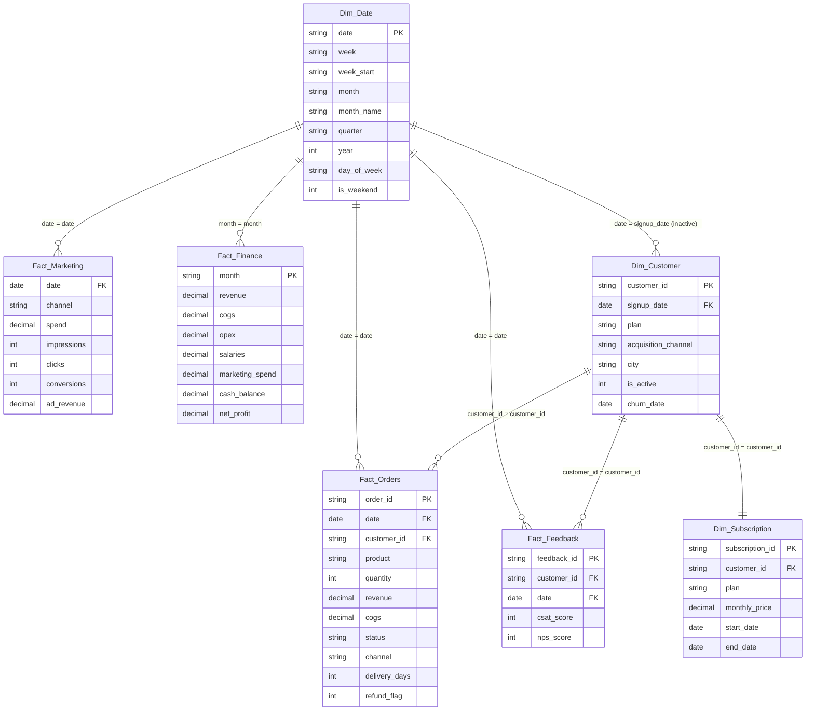

# NutriBox Power BI Data Model Specification
**Architecture:** Enterprise Star Schema with Conformed Date & Customer Dimensions  
**Engine:** Microsoft Power BI / Analysis Services Tabular  
**Currency:** Indian Rupee (INR, ₹)

---

## 1. Conceptual & Logical Data Model Diagram

---

## 2. Table Specifications & Data Types

### 2.1 `Dim_Date` (Role: Central Conformed Dimension)
* **Mark as Date Table:** Yes (Key: `date`)
* **Source:** `date_table.csv`

| Column Name | Power BI Data Type | Format String | Description |
| :--- | :--- | :--- | :--- |
| `date` | Date (`DateTime.Date`) | `yyyy-mm-dd` | Primary Key. Daily timestamp. |
| `week` | Text | `@` | Standard ISO week identifier (`W01` to `W52`). |
| `week_start` | Date | `yyyy-mm-dd` | Monday starting date of the week. |
| `month` | Text | `yyyy-mm` | Year-month key for finance join (`2024-09`). |
| `month_name`| Text | `@` | Display name (`September 2024`). Sort by `month`. |
| `quarter` | Text | `@` | Calendar quarter (`2024-Q3`). |
| `year` | Whole Number | `0` | Calendar year (`2023`, `2024`). |
| `day_of_week`| Text | `@` | Day name (`Monday`, `Tuesday`, etc.). |
| `is_weekend` | Whole Number | `0` | Flag: 1 for Saturday/Sunday, 0 for weekdays. |

---

### 2.2 `Dim_Customer` (Role: Customer Dimension)
* **Source:** `customers.csv`

| Column Name | Power BI Data Type | Format String | Description |
| :--- | :--- | :--- | :--- |
| `customer_id` | Text | `@` | Primary Key (`CUST-1001`). |
| `signup_date` | Date | `yyyy-mm-dd` | Date customer registered subscription. |
| `plan` | Text | `@` | Subscribed tier (`Weekly Snack Box`, etc.). |
| `acquisition_channel` | Text | `@` | Sourced channel (`Instagram`, `Google`, etc.). |
| `city` | Text | `@` | Delivery metro (`Bengaluru`, `Mumbai`, etc.). |
| `is_active` | Whole Number | `0` | 1 if actively subscribing, 0 if churned. |
| `churn_date` | Date (Nullable) | `yyyy-mm-dd` | Cancellation date if churned. |

---

### 2.3 `Dim_Subscription` (Role: Contracted Tier Dimension)
* **Source:** `subscriptions.csv`

| Column Name | Power BI Data Type | Format String | Description |
| :--- | :--- | :--- | :--- |
| `subscription_id` | Text | `@` | Primary Key (`SUB-2001`). |
| `customer_id` | Text | `@` | Foreign Key to `Dim_Customer`. |
| `plan` | Text | `@` | Plan tier name. |
| `monthly_price` | Decimal Number | `₹#,##0` | Recurring monthly subscription price. |
| `start_date` | Date | `yyyy-mm-dd` | Subscription start date. |
| `end_date` | Date (Nullable) | `yyyy-mm-dd` | Expiration or churn date. |

---

### 2.4 `Fact_Orders` (Role: Transactional Fact)
* **Source:** `orders.csv` (~15,102 rows)

| Column Name | Power BI Data Type | Format String | Description |
| :--- | :--- | :--- | :--- |
| `order_id` | Text | `@` | Primary Key (`ORD-10001`). |
| `date` | Date | `yyyy-mm-dd` | Foreign Key to `Dim_Date[date]`. |
| `customer_id` | Text | `@` | Foreign Key to `Dim_Customer[customer_id]`. |
| `product` | Text | `@` | SKU ordered (`Keto Seeds Delight`, etc.). |
| `quantity` | Whole Number | `#,##0` | Units in order. |
| `revenue` | Decimal Number | `₹#,##0.00` | Recognized gross value of transaction. |
| `cogs` | Decimal Number | `₹#,##0.00` | Cost of goods sold for transaction. |
| `status` | Text | `@` | `Delivered`, `Pending`, `Refunded`. |
| `channel` | Text | `@` | Attribution marketing channel. |
| `delivery_days`| Whole Number | `0` | Order-to-door transit duration. |
| `refund_flag` | Whole Number | `0` | 1 if refunded, 0 otherwise. |

---

### 2.5 `Fact_Marketing` (Role: Marketing Performance Fact)
* **Source:** `marketing.csv` (1,820 rows)

| Column Name | Power BI Data Type | Format String | Description |
| :--- | :--- | :--- | :--- |
| `date` | Date | `yyyy-mm-dd` | Foreign Key to `Dim_Date[date]`. |
| `channel` | Text | `@` | Acquisition channel (`Instagram`, `Google`, etc.). |
| `spend` | Decimal Number | `₹#,##0.00` | Paid ad spend invested. |
| `impressions` | Whole Number | `#,##0` | Storefront ad impressions. |
| `clicks` | Whole Number | `#,##0` | Traffic clicks generated. |
| `conversions` | Whole Number | `#,##0` | Storefront checkout conversions. |
| `ad_revenue` | Decimal Number | `₹#,##0.00` | Attributed platform ad revenue. |

---

### 2.6 `Fact_Feedback` (Role: Customer Sentiment Fact)
* **Source:** `feedback.csv` (8,219 rows)

| Column Name | Power BI Data Type | Format String | Description |
| :--- | :--- | :--- | :--- |
| `feedback_id` | Text | `@` | Primary Key (`FB-1001`). |
| `customer_id` | Text | `@` | Foreign Key to `Dim_Customer[customer_id]`. |
| `date` | Date | `yyyy-mm-dd` | Foreign Key to `Dim_Date[date]`. |
| `csat_score` | Whole Number | `0` | CSAT satisfaction score (1 to 5). |
| `nps_score` | Whole Number | `0` | NPS recommendation score (0 to 10). |

---

### 2.7 `Fact_Finance` (Role: Financial Ledger Fact)
* **Source:** `finance.csv` (12 rows)

| Column Name | Power BI Data Type | Format String | Description |
| :--- | :--- | :--- | :--- |
| `month` | Text | `yyyy-mm` | Primary Key / Foreign Key to `Dim_Date[month]`. |
| `revenue` | Decimal Number | `₹#,##0.00` | Monthly recognized revenue (reconciled). |
| `cogs` | Decimal Number | `₹#,##0.00` | Monthly COGS (reconciled). |
| `opex` | Decimal Number | `₹#,##0.00` | Operational expenses. |
| `salaries` | Decimal Number | `₹#,##0.00` | Team payroll costs. |
| `marketing_spend` | Decimal Number | `₹#,##0.00` | Total marketing spend (reconciled). |
| `cash_balance` | Decimal Number | `₹#,##0.00` | End-of-month liquid cash reserve. |
| `net_profit` | Decimal Number | `₹#,##0.00` | Bottom-line net profit/loss. |

---

## 3. Relationships & Model Topology

| From Table (Fact / Child) | Foreign Key Column | To Table (Dim / Parent) | Primary Key Column | Cardinality | Cross-Filter Direction | Status |
| :--- | :--- | :--- | :--- | :---: | :---: | :---: |
| `Fact_Orders` | `date` | `Dim_Date` | `date` | Many to One (`*:1`) | Single (`Dim_Date` filters `Fact_Orders`) | **Active** |
| `Fact_Orders` | `customer_id` | `Dim_Customer` | `customer_id` | Many to One (`*:1`) | Single (`Dim_Customer` filters `Fact_Orders`) | **Active** |
| `Fact_Marketing` | `date` | `Dim_Date` | `date` | Many to One (`*:1`) | Single (`Dim_Date` filters `Fact_Marketing`) | **Active** |
| `Fact_Feedback` | `date` | `Dim_Date` | `date` | Many to One (`*:1`) | Single (`Dim_Date` filters `Fact_Feedback`) | **Active** |
| `Fact_Feedback` | `customer_id` | `Dim_Customer` | `customer_id` | Many to One (`*:1`) | Single (`Dim_Customer` filters `Fact_Feedback`) | **Active** |
| `Dim_Subscription`| `customer_id` | `Dim_Customer` | `customer_id` | One to One (`1:1`) | Both | **Active** |
| `Dim_Customer` | `signup_date` | `Dim_Date` | `date` | Many to One (`*:1`) | Single | *Inactive* (Activated via `USERELATIONSHIP`) |

---

## 4. Modeling Best Practices for Power BI Desktop

1. **Disable Auto Date/Time:** In `File > Options and Settings > Options > Current File > Data Load`, uncheck **Auto Date/Time**.
2. **Hide Foreign Key Columns:** Hide all `*_id` and `date` join columns in Fact tables from the Report View to guide users to use Dimensions.
3. **Dedicated Measure Table:** Create an empty table `_Measures` using `Enter Data` and place all DAX measures there, organized into display folders (`01_Sales`, `02_Marketing`, `03_Finance`, `04_Operations`, `05_Time_Intelligence`).
4. **Sort By Column:** Ensure `Dim_Date[month_name]` is explicitly set to **Sort By Column** `Dim_Date[month]`.
